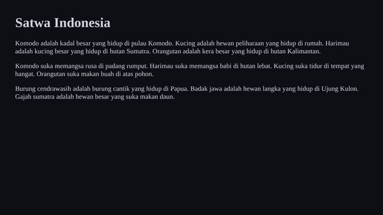
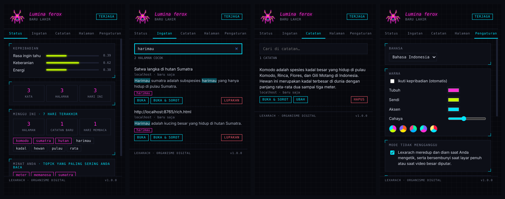

<p align="center"></p>

# Lexarach

*Dibaca "lek-sa-rak". Dari **lexicon** (kosakata) + **arachnid** (laba-laba).*

**Laba-laba robot pemakan kosakata yang hidup di browser Anda dan mengingat semua yang Anda baca.**



> 🇬🇧 *Lexarach (lexicon + arachnid) is a Chrome extension: a small robot spider that lives on the pages you read. It "eats" words,
> builds an on-device memory of your reading (TF-IDF keywords + key sentences), lets you search it with an
> Indonesian stemmer, saves highlighted text as notes, and behaves like a living creature: hunger, rest,
> grooming, jumping, web-building and swinging on a thread, with a personality shaped by how you treat it.
> Everything stays on your computer. UI in Indonesian and English.*

---

## Fitur utama

| | Fitur | Keterangan |
|---|---|---|
| 🔎 | **Ingatan halaman** | Halaman yang Anda baca lebih dari 8 detik dicatat (30 kata kunci + 6 kalimat inti). Cari dengan kata apa pun: "dimangsa" menemukan halaman yang berisi "memangsa". |
| 🖍️ | **Buka & sorot** | Buka hasil pencarian dan kalimat yang cocok langsung disorot di halaman. |
| 📝 | **Beri makan Lexarach** | Blok teks lalu klik tombol, klik kanan, atau tekan **Alt+R**: teks tersimpan sebagai catatan yang bisa dicari, diubah, dan dihapus. |
| 📄 | **Ringkas & tandai** | Ringkasan 3–5 kalimat inti dan kata kunci halaman, lalu tandai kalimatnya langsung di halaman. |
| 📊 | **Laporan mingguan** | Jumlah halaman, catatan, hari membaca, dan topik utama 7 hari terakhir. |
| 💬 | **Gumaman** | Komentar kecil berdasarkan fakta: kata baru, bacaan lama yang mirip, lama membaca. |
| 🕷️ | **Hidup** | Lapar, istirahat, membersihkan diri, melompat, merajut jaring, bergelantung; kepribadian berubah sesuai perlakuan Anda. |
| 🔒 | **Privasi** | Semua data di komputer Anda. Tidak ada server, analitik, atau permintaan jaringan. Situs bank, surel, dan halaman login dilewati. |
| 🎛️ | **Kendali** | Mode per situs (normal / sembunyi / mati), mode tidak mengganggu, warna kustom, cadangan JSON & Markdown. |



## Memasang

1. Unduh atau `git clone https://github.com/zeevolker/lexarach` repositori ini.
2. Buka `chrome://extensions` lalu aktifkan **Mode pengembang**.
3. Klik **Muat yang belum dibuka** (*Load unpacked*), pilih folder ini.
4. Buka situs berita atau Wikipedia, lalu tunggu Lexarach merayap masuk.

> ⚠️ ID extension yang dimuat secara *unpacked* bergantung pada lokasi folder. Jangan memindahkan folder
> setelah dipasang, atau ekspor cadangan dulu (Pengaturan → Cadangan).

Pintasan **Alt+R** bisa diubah di `chrome://extensions/shortcuts`.

## Cara memakai

- **Mencari bacaan lama**: klik ikon Lexarach → tab **Ingatan** → ketik kata.
- **Menyimpan kutipan**: blok teks → *◆ Beri makan Lexarach* (atau Alt+R).
- **Meringkas halaman**: tab **Halaman** → *Ringkas*, lalu *Tandai*.
- **Memindahkan Lexarach**: tab Status → *Tidurkan*, lalu seret tubuhnya.
- **Mengelus**: gerakkan pointer pelan di dekatnya. Gerakan cepat ke arahnya akan mengagetkannya.

## Teknologi

JavaScript murni, tanpa *framework* atau *library*. Chrome Extension Manifest V3.

| Bagian | Teknik |
|---|---|
| Ringkasan & kata kunci | TF-IDF ekstraktif, bobot IDF dari kata yang pernah dilihat Lexarach |
| Pencarian | *Stemmer* bahasa Indonesia (gaya Nazief–Adriani yang disederhanakan), dua kandidat kata dasar |
| Gerak | *Steering behaviors* (Reynolds): *seek*, *arrive*, *wander*; gaya lari-berhenti |
| Kaki | *Inverse kinematics* dua tulang (hukum kosinus), gaya berjalan tetrapod |
| Kegiatan | Lompatan parabola, bandul teredam saat bergelantung, jaring tiga fase |
| Sorotan | CSS Custom Highlight API (DOM halaman tidak diubah) |
| Asosiasi | Kemiripan Jaccard saat "tidur" |

Penjelasan lengkap:
- [docs/ARCHITECTURE.md](docs/ARCHITECTURE.md): komponen, alur pesan, dan penyimpanan
- [docs/ALGORITHMS.md](docs/ALGORITHMS.md): algoritma dengan rumus dan potongan kode
- [PRIVACY.md](PRIVACY.md): kebijakan privasi
- [CHANGELOG.md](CHANGELOG.md): riwayat perubahan

## Struktur

```
lexarach/
├── manifest.json
├── _locales/{id,en}/messages.json
├── src/
│   ├── shared/        lang.js (stemmer), speech.js (pasangan kata)
│   ├── content/       insight.js + 00-setup … 08-life (tubuh, indra, suara, makan, kegiatan, gerak, gambar, siklus hidup)
│   ├── background/    background.js (memori, pencarian ingatan, tab aktif, mimpi)
│   └── popup/         popup.html, popup.js
├── icons/             ikon 16–128 px + sumber SVG
├── store/             bahan Chrome Web Store (teks, gambar, skrip ZIP)
└── docs/
```

## Lisensi

[MIT](LICENSE) © 2026. Sebelumnya bernama *Renik*. Terinspirasi secara bebas oleh *Crawlers* karya Slava Rybin; seluruh kode dan desain Lexarach dibuat sendiri.
