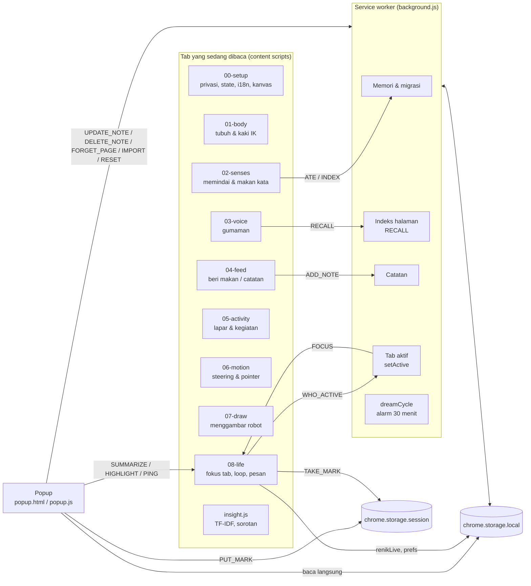

# Arsitektur Lexarach

Lexarach adalah extension Chrome Manifest V3 dengan tiga bagian yang berbicara lewat `chrome.runtime` pesan
dan berbagi data lewat `chrome.storage`.

## Content scripts

Semua file di `src/content/` dimuat berurutan (lihat `manifest.json`) ke **satu isolated world**, jadi
`const`/`let` tingkat atas di satu file bisa dipakai file berikutnya. Urutannya disusun supaya setiap file
hanya bergantung pada file sebelumnya; hanya `08-life.js` yang menjalankan `main()`.

| File | Tanggung jawab |
|---|---|
| `00-setup.js` | Penjaga privasi (`isBlockedPage`, kolom kata sandi), penanda injeksi, `state`, teks i18n, mode situs, mode tidak mengganggu, kanvas |
| `01-body.js` | Posisi, arah, ukuran; geometri kaki; gaya berjalan; `solveKnee` |
| `02-senses.js` | Memindai kata yang terlihat, memilih incaran, makan, mengirim indeks halaman |
| `03-voice.js` | Panel gumaman, jeda, gumaman berbasis fakta |
| `04-feed.js` | Tombol *Beri makan Lexarach*, simpan catatan, efek remah |
| `05-activity.js` | Rasa lapar, pemilihan kegiatan, lompat, jaring, bergelantung |
| `06-motion.js` | Mesin keputusan gerak per bingkai, reaksi pointer, kaget/dielus |
| `07-draw.js` | Palet warna, jaring, benang, robot, panel HUD |
| `08-life.js` | Fokus tab, masuk dari tepi layar, loop animasi, diseret kapan saja, pesan dari popup/background |
| `insight.js` | `LexarachInsight`: ringkasan TF-IDF, indeks halaman, sorotan |

`src/shared/lang.js` (stemmer) dan `src/shared/speech.js` dipakai **content script dan service worker**
sekaligus (`importScripts`), sehingga kata dasar dihitung dengan cara yang sama di kedua sisi.

## Satu Lexarach untuk banyak tab

Setiap tab memuat skrip, tetapi hanya tab aktif yang menghidupkan Lexarach:

1. Tab baru bertanya `WHO_ACTIVE`.
2. `background.js` memantau `tabs.onActivated` dan `windows.onFocusChanged`, lalu mengirim `FOCUS`
   ke tab baru (`active: true`, arah masuk) dan ke tab lama (`active: false`).
3. Tab lama menitipkan posisi ke `renikLive` lalu berhenti total (tanpa `requestAnimationFrame`).
4. Tab baru menunggu 0,6–1,8 detik, lalu Lexarach merayap masuk dari tepi yang berlawanan dengan arah perpindahan tab.

Saat extension diperbarui, skrip lama kehilangan `chrome.runtime` dan menghapus dirinya sendiri
(`checkOrphan`). `onInstalled` memasang skrip baru hanya ke tab yang selesai dimuat dan belum
memiliki penanda `window.__lexarachInjected`, untuk mencegah injeksi ganda.

## Penyimpanan

| Kunci | Tempat | Isi |
|---|---|---|
| `renik` | local | Kepribadian, frekuensi kata, statistik, jurnal mimpi, hubungan kata |
| `renikLang` | local | Pasangan kata berurutan (bahan asosiasi) |
| `renikPages` | local | Indeks halaman (maks. 400): judul, URL tanpa query, kata kunci, cuplikan |
| `renikNotes` | local | Catatan (maks. 500, 3000 karakter) |
| `renikStyle` | local | Warna |
| `renikPrefs` | local | Bahasa, kehadiran global (`global`), mode situs, mode tidak mengganggu, ingatan halaman aktif/tidak |
| `renikLive` | local | Posisi & arah terakhir (untuk perpindahan tab) |
| `activeTab`, tanda sorot | session | Tab yang dihuni; kalimat yang menunggu disorot (kedaluwarsa 60 dtk) |

Awalan `renik` berasal dari nama lama proyek. Awalan ini sengaja dipertahankan agar ingatan pengguna
lama tetap terbaca setelah ganti nama.

`update(mutator, touched)` di background hanya menulis ulang kunci yang berubah. Data versi lama
(semua dalam `renik`) dipindahkan otomatis.

## Izin

| Izin | Alasan |
|---|---|
| `storage` | Menyimpan memori di komputer pengguna |
| `alarms` | Merapikan ingatan (konsolidasi & asosiasi kata) tiap 30 menit |
| `scripting` | Memasang ulang Lexarach ke tab yang sudah terbuka setelah pembaruan |
| `contextMenus` | Menu klik kanan *Beri makan Lexarach* |
| host `http/https` | Lexarach perlu membaca teks halaman yang Anda kunjungi |
